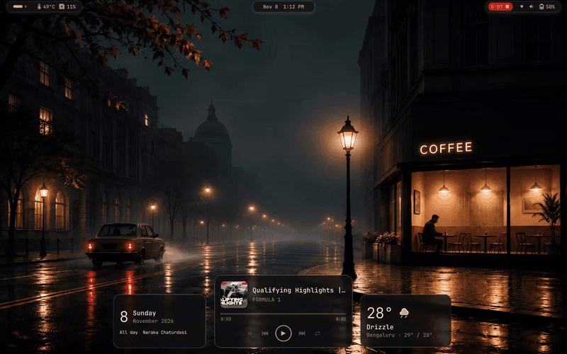
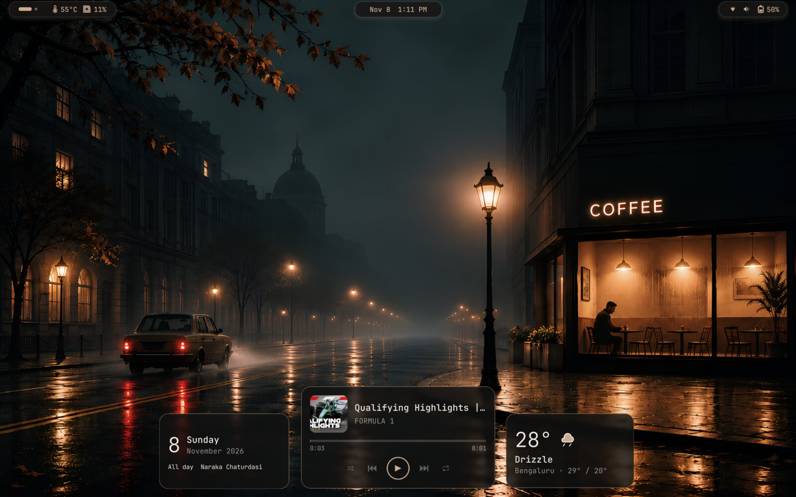
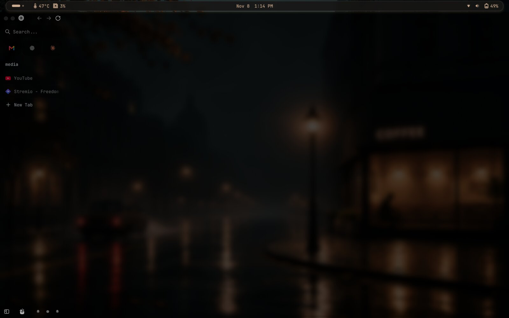
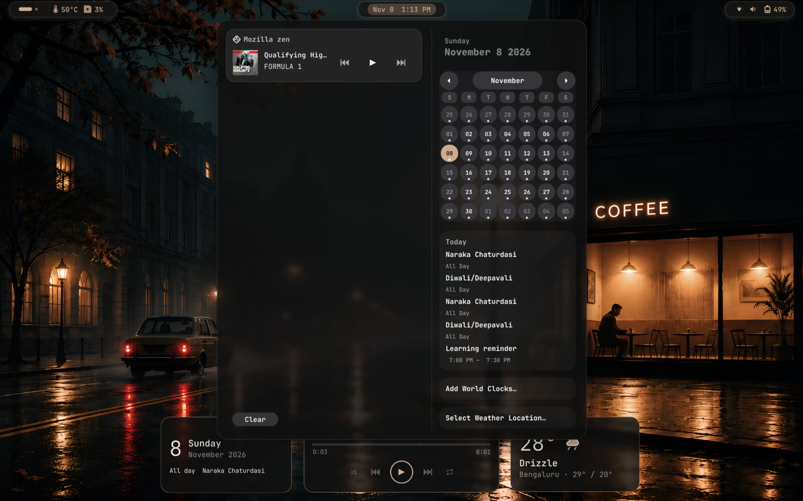
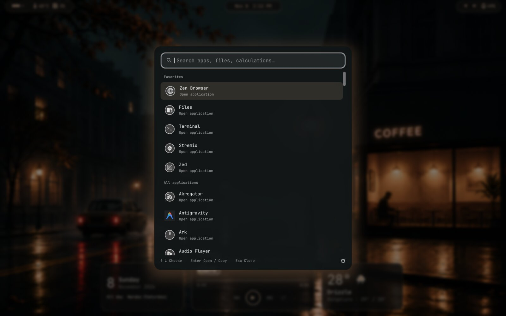
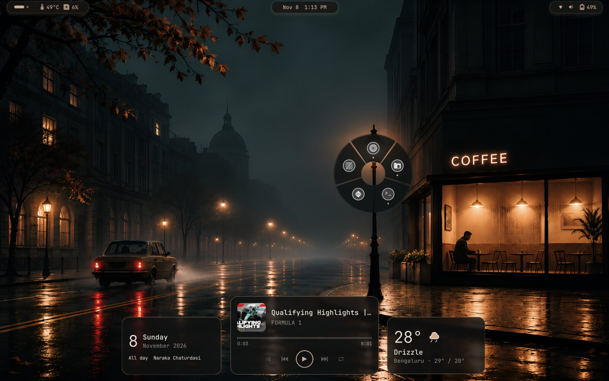
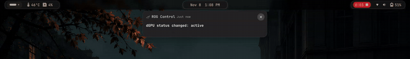

# Charcoal GNOME theme bundle

[](media/demo.mp4)

Click the animation for the full-quality video.

| | |
| --- | --- |
|  **Desktop:** islands top bar, calendar, music and weather widgets |  **Maximized window:** the islands join into one full bar (shown with *Invert automatic layout* on) |
|  **Calendar menu:** styled notifications, media controls and events |  **Super+Space search:** apps, files and calculations |
|  **Favorites wheel:** hold Super | [](media/topbar-layout.mp4) **Automatic layout:** the bar splits and joins as windows open and maximize (click for video) |

A charcoal-and-glass desktop for **GNOME Shell 51**, with seven configurable
extensions, GTK4 styling, icons and a cursor theme. Install the whole bundle or
choose individual pieces. Theme files install for your user, with a backup and
restore command.

| Extension | What it does |
| --- | --- |
| Charcoal Topbar (`charcoal-topbar@local`) | Floating bar or islands, automatic layout changes, styled menus and notifications, blur |
| Charcoal Appearance (`charcoal-appearance@local`) | Icon and cursor themes, dark/light style, window buttons, automatic GreyStone icon updates |
| Charcoal Launchers (`charcoal-launchers@local`) | Super+Space search, hold-Super favorites wheel, window previews, radial dock and touchpad gestures |
| Charcoal Widgets (`charcoal-widgets@local`) | Resizable weather, calendar and music cards on the empty desktop |
| Charcoal Themes (`charcoal-themes@local`) | Named presets for Charcoal appearance, layout, and desktop wallpaper |
| Charcoal Control Wheel (`charcoal-controls@local`) | Separate wheel for actions, quick notes, settings, and theme switching |

Blur comes from the bundled **Blur My Shell** extension. Static blur uses only the
wallpaper and is the default; live blur can be selected in each extension's
preferences and costs more GPU time. Search and wheel share their static/live setting.

## Contents

- [Install from scratch](#install-from-scratch)
- [Installer options](#installer-options)
- [Open preferences](#open-preferences)
- [Coordinated themes](#coordinated-themes)
- [Top bar](#top-bar)
- [Desktop appearance and icon updates](#desktop-appearance-and-icon-updates)
- [Search and favorites launchers](#search-and-favorites-launchers)
- [Look options](#look-options)
- [Desktop widgets](#desktop-widgets)
- [Included files and scope](#included-files-and-scope)
- [Backup and restore](#backup-and-restore)
- [Troubleshooting and compatibility](#troubleshooting-and-compatibility)
- [Development and verification](#development-and-verification)
- [License](#license)

## Install from scratch

### 1. Start with a compatible desktop

On a bare machine, first install Linux and a GNOME desktop using your distribution's
guide: [Fedora](https://docs.fedoraproject.org/en-US/fedora/latest/getting-started/),
[Debian](https://www.debian.org/releases/stable/installmanual),
[Ubuntu Desktop](https://ubuntu.com/tutorials/install-ubuntu-desktop), or
[Arch Linux](https://wiki.archlinux.org/title/Installation_guide)
([GNOME setup](https://wiki.archlinux.org/title/GNOME)). Create a normal user and log
into its GNOME desktop. Open Terminal and check:

```bash
gnome-shell --version
```

**Continue with activation only if this reports GNOME Shell 51.x.** Not every
release of these distributions ships GNOME 51. If you have another Shell version, follow your
distribution's supported desktop/release upgrade process or use the file-only
option below. Charcoal does not install GNOME, change desktop environments, upgrade
your distribution, or bypass extension version checks.

### 2. Install the prerequisites

You need **Bash**, **Python 3.9 or newer** (the `python3` command), **Git**, and the
GNOME utilities `glib-compile-schemas`, `gsettings` and `gjs`. **Flatpak** is only
needed for the optional Extension Manager. No pip packages or Python virtual
environment are needed. The installer never runs sudo or installs system packages;
install these yourself with your distribution's package manager. Common examples:

**Fedora**:

```bash
sudo dnf install git python3 bash glib2 gjs flatpak
```

**Debian / Ubuntu**:

```bash
sudo apt update
sudo apt install git python3 bash libglib2.0-bin gjs flatpak
```

**Arch Linux** (on an up-to-date system; avoid a partial `pacman -Sy`):

```bash
sudo pacman -S --needed git python bash glib2 gjs flatpak
```

On other distributions, install the equivalent packages. Most GNOME desktops
already include everything except possibly Git. A distribution update can change
your GNOME version, so check it again before activating Charcoal.

Check the installed interpreter:

```bash
python3 --version
```

### 3. Download and preview

```bash
git clone https://github.com/rajath-2/charcoal-gnome.git
cd charcoal-gnome
./install.sh --dry-run
```

The dry run makes no changes, performs no downloads and asks no questions. If a
prerequisite is missing it names it and exits; install it and run the preview again.

### 4. Install

```bash
./install.sh
```

Add `--install-extension-manager` to also be offered the optional
[Extension Manager](#optional-extension-manager) GUI. The theme installation needs
no downloads, root access or confirmation prompts.

Always run `install.sh` as your normal desktop user. **Do not use `sudo ./install.sh`:**
the installer refuses root execution.

### 5. Log out and back in

Save your work, then log out of GNOME and log back in. GNOME caches extension
JavaScript for the session; toggling an extension does not reliably load newly
installed or updated code. Restart open GTK applications to load their CSS. The
installer never logs you out.

Open [preferences](#open-preferences), choose your weather city, and try
**Super+Space** for search or **hold Super** for the favorites wheel.

## Installer options

```bash
./install.sh --help
```

| Option | Effect |
| --- | --- |
| `--only PIECE [PIECE ...]` | Install any combination of `topbar`, `appearance`, `launchers`, `widgets`, `themes`, `controls`; default: all |
| `--mode auto\|compact\|islands` | Choose the top bar's starting layout; default: `auto` |
| `--no-activate` | Copy files and compile schemas without changing desktop settings or enabling extensions |
| `--dry-run` | Preview without writes, prompts or downloads |
| `--install-extension-manager` | Offer the optional Extension Manager GUI as a per-user Flatpak (no sudo) |
| `--restore BACKUP_DIR` | Restore a previous theme backup; may be combined with `--dry-run` |

Examples:

```bash
./install.sh --only topbar                 # Topbar + Blur My Shell
./install.sh --only appearance             # Appearance + GTK4 CSS, icons, cursor
./install.sh --only launchers              # Launchers + Blur My Shell
./install.sh --only widgets                # Widgets + Blur My Shell
./install.sh --only themes                 # Theme engine only
./install.sh --only controls               # Control wheel only
./install.sh --only topbar launchers --mode islands
./install.sh --mode compact                # all pieces, fixed compact top bar
./install.sh --no-activate                 # file-only installation
```

Each installation creates a new backup. Omitted components' files are left alone;
components that need blur share the bundled Blur My Shell. Only `topbar` configures
the initial layout and blur profiles and retires the older top-bar setup. Each
selected component can still enable its own extension and apply its preferences.

### Dependencies

Activation requires GNOME Shell 51, a running GNOME session, `gsettings`, `gjs` and
`glib-compile-schemas`, in addition to Bash and Python. File-only installation with
`--no-activate` needs only `glib-compile-schemas`. It can copy onto other desktop
versions but does not make the extensions compatible with them.

The installer never installs system packages or runs sudo. If a tool is missing it
stops before any backup or file change and names the missing commands; install them
with your distribution's package manager (see [step 2](#2-install-the-prerequisites)) and rerun.

| Command | Fedora / Arch package | Debian / Ubuntu package |
| --- | --- | --- |
| `glib-compile-schemas`, `gsettings` | `glib2` | `libglib2.0-bin` |
| `gjs` | `gjs` | `gjs` |
| `flatpak` (optional, Extension Manager only) | `flatpak` | `flatpak` |

### Optional Extension Manager

[Extension Manager](https://github.com/mjakeman/extension-manager) provides a GUI
for enabling/disabling extensions and opening their preferences. It is optional;
the extensions and command-line preferences work without it. Upstream recommends
Flatpak. `--install-extension-manager` recognizes an existing native, user Flatpak
or system Flatpak installation; otherwise it shows this command and asks before
running it (**Enter means no**):

```bash
flatpak install --user --from https://dl.flathub.org/repo/appstream/com.mattjakeman.ExtensionManager.flatpakref
```

`--user` installs it for your account only, so no sudo is needed; see
[Flatpak's documentation](https://docs.flatpak.org/en/latest/using-flatpak.html).
Flatpak may also download a runtime and configure the Flathub remote. If Flatpak
itself is missing, or the GUI install is declined or fails, the installer prints a
warning and continues with the theme.

**System packages, Flatpak apps/runtimes and remote configuration are outside
Charcoal's backup and restore.** Manage those with your package manager or Flatpak.

## Open preferences

Launch **Extension Manager → Installed**, or GNOME's **Extensions** app, and open
the preferences/settings button next to the relevant Charcoal extension. The
`gnome-extensions` command is another route:

```bash
gnome-extensions prefs charcoal-topbar@local
gnome-extensions prefs charcoal-appearance@local
gnome-extensions prefs charcoal-launchers@local
gnome-extensions prefs charcoal-widgets@local
gnome-extensions prefs charcoal-themes@local
```

To launch a Flatpak installation of Extension Manager from Terminal:

```bash
flatpak run com.mattjakeman.ExtensionManager
```

Settings normally apply immediately and survive reinstalling the bundle. The
installer's `--mode` selects the top bar's initial layout on activation; use
preferences to change it afterward. You can enable or disable each extension
individually. Keep Blur My Shell enabled for Charcoal's blur effects.

## Coordinated themes

Use **Export selected theme…** in Charcoal Themes preferences to save a portable
JSON file containing the theme settings and wallpaper. Use **Import theme…** to
add an exported file as a new theme, then select **Apply theme** when ready.
Existing themes are preserved. Exports support wallpapers up to 32 MiB; missing
wallpaper files must be reselected before exporting. Imported wallpaper copies
are stored in `~/.config/charcoal/themes/wallpapers/`. Theme exports do not bundle
installed fonts, icon packs, or extensions.

Open **Charcoal Themes** preferences to create a theme from your current
settings, duplicate or rename one, choose a desktop wallpaper, and edit values
for Topbar, Appearance, Launchers, Widgets, and the Control Wheel. Applying a theme changes its
wallpaper immediately. Each other Charcoal extension has a **Follow active
theme** switch in its own preferences; existing installations start with that
switch off, preserving their current settings.

When linked, a local edit becomes a saved override for that extension. **Use
theme values** makes its overrides dormant, and **Restore saved local overrides**
brings them back. Switching themes also makes local overrides dormant without
deleting their values. **Save active overrides to this theme** writes only the
settings you changed locally into the selected theme. Shortcuts, favorites,
weather city, enabled widgets, and other feature or personal settings always
stay local. If the theme engine is disabled or unavailable, linked extensions
use their saved local settings.

## Control wheel

Set a shortcut for the separate control wheel in **Charcoal Control Wheel**
preferences (none is set by default; press **Set shortcut** and then the keys).
Hold the shortcut, move the pointer onto an item and release to run it; release over
the centre to cancel. Clicking an item also works. Its items are lock, suspend, log out, restart, power off, a quick note, Charcoal
settings and themes; turn each on or off under **Wheel items**.
Select **Themes** for a second ring of saved profiles; the applied theme is
filled with the accent colour and named in the centre. Log out, restart, and power off ask for confirmation. Quick notes
are stored as UTF-8 text files under `~/.local/share/charcoal/notes/` and are
never included in a theme. Wheel appearance is also set in its preferences.

## Top bar

**Automatic** mode shows a full floating bar when no visible app on the current
workspace and panel monitor is fully maximized; it splits into islands when one
is maximized. Controls stay anchored while the background splits or joins.
**Invert automatic layout** swaps those states: islands on the desktop and a full
bar with a maximized app. Fixed **Compact bar** and **Islands** modes are also available.

In **Top bar** preferences you can change layout, static/live blur, height, corner
radius, the gap above/below, and separate side gaps for compact versus islands/auto.
The default compact mode has 72px side margins; automatic mode uses 18px in both
states. Menus include popup handoffs and a lighter blur profile.

The **Appearance** page controls bar color, separate fixed-islands opacity,
text/icons, text size and boldness, highlights, outlines, shadows, and menu/popup
background, text, opacity and corner radius. These cover quick settings, calendar,
notifications and panel menus. **Reset appearance** restores colors, sizes and
spacing while retaining layout, inversion and static/live blur.

## Desktop appearance and icon updates

Charcoal Appearance applies the bundled **GreyStone - circle** icons,
**Future-black-cursors**, dark style and left-side window controls while enabled.
Its preferences let you select other installed icon/cursor themes, set cursor size
(16–96), choose Dark/Default/Light, and edit GNOME's window-button layout.
For example, `close,minimize,maximize:` places buttons on the left;
`:minimize,maximize,close` places them on the right. Apply the entry after editing.
Disabling this extension restores the icon, cursor, color-scheme and button
settings that were active before it was enabled; the installed GTK4 files remain
until you [restore the backup](#backup-and-restore).

Automatic GreyStone updates are enabled by default. Once a day the extension
checks [upstream on Codeberg](https://codeberg.org/StormRosenaa/GreyStone), downloads
a newer release when available, and swaps it into your user icons directory only
after extraction succeeds. This runtime feature uses the network even though the
default **installer** is offline. It requires `tar` to extract downloaded archives.
Turn off **Update automatically** for offline use, or use **Check now** to check
manually and see the installed version or an error. Re-running `install.sh` with
appearance selected restores the bundled copy until the next successful update.

## Search and favorites launchers

- **Super+Space:** centered search for applications, files, calculations, settings, and installable apps (opens GNOME Software; nothing is installed from search).
- **Search style:** Preferences → Search → Style. **Classic** is the centered panel over a dimmed, blurred screen with headings; **Minimal** is a glass bar in the middle of the screen (it slides up only when results need the room) that grows into one flat results card, with nothing else dimmed. Minimal opens as a small search circle that grows into the bar (and shrinks back on close); Style → Minimal bar position moves the bar up or down (percent of the screen, 50 is centre); Look and motion → Minimal icon grow-out sets how long the circle takes to grow in; with animations off it simply appears.
- **Tap Super:** workspace overview.
- **Hold Super:** compact favorites wheel at the cursor. Move toward an app and release
  to launch: the direction picks it, so overshooting past the wheel still selects the
  outermost app that way. Release in the center (or press Esc) to cancel.
- **Your own trigger keys:** Preferences → Wheel → Trigger adds, changes or removes keys
  that open the wheel while held. You can turn off Hold Super there too. For a mouse side
  button, map it to a key such as F13 in the mouse's software, Piper or Input Remapper,
  then add that key: GNOME doesn't let extensions see clicks made on app windows.
- **Esc:** cancel. Other Super shortcuts cancel the wheel and retain their action.
- **Window previews:** rest on a running app for a moment to see its windows beside the wheel.
  Move out to them (the app stays selected along its direction) and release on one to bring
  that exact window up. In dock mode, releasing on the focused window minimizes it.
- **Three-finger touchpad:** rest three fingers (same hold delay) to open the wheel at the
  pointer, slide toward an app, and lift to open it. Lifting without sliding cancels. Quick
  three-finger swipes still switch workspaces and open the overview.
- **Radial dock mode** (Preferences): running apps join the wheel as outer rings. Windows
  open out of the cursor, and releasing on the focused app minimizes it into the cursor;
  releasing on it again restores it from there. Every minimize and restore in this mode
  (Super+H, the title-bar button) also goes into and out of the cursor. With the dock hidden,
  Super+1…9 open the 1st…9th wheel favorite (clockwise from the top) the same way.
  **Also show desktop dock** keeps your bottom dock; **Show dock only on hover** then keeps it
  hidden until the pointer touches the bottom edge (your Dash to Dock settings come back when off).

Open **Extensions → Charcoal Launchers → Preferences**, or run:

```bash
gnome-extensions prefs charcoal-launchers@local
```

**General** lets you enable search and the wheel independently. **Wheel** lets you add,
remove and reorder up to 12 favorites, clockwise from the top. The initial list is
copied from your dock, then maintained independently. You can tune radius, outer
ring width, icon size, center size and sector spacing. **Search** controls panel
width, maximum screen height, result icon size and corner radius.

Preferences also include separate wheel and search colors, opacity,
blur (search panel and wheel, static or live), search categories, result limit, shortcut, hold delay, and animation
speed. Defaults use a 240-pixel ring with a transparent center, separate app sectors,
and short fade/scale animations. The wheel's blur follows its sector shapes. The system's
animation setting is respected. Settings survive reinstalling the bundle.

Super+Space normally switches keyboard layouts. The extension temporarily removes
that exact conflict and restores it when disabled. Other shortcut collisions are
reported in Preferences instead of overriding them. Disabling the wheel restores
GNOME's original Super action. Avoid enabling another Super-key remapper alongside
this extension.

File results depend on GNOME Files and its search index; this is not a whole-disk
scan. GNOME Search privacy settings are respected. Calculator, Settings and Software (installable apps) require
their installed GNOME search providers. Enter copies calculation results; ordinary
results open their application or file. Unavailable providers are shown separately (Classic; Minimal leaves them out).

**Appearance → Motion** can disable animations or use fade without scaling.
**Reset launcher preferences** restores appearance, controls and shortcuts, and
replaces your wheel favorites with a fresh copy from the dock.

## Look options

The top bar, its menus, the search panel, the wheel and the widgets each have their own
background, outline (color, width, strength) and shadow (color, size, strength; a bright
color reads as a glow) in their Appearance preferences. The bar and the search panel also
have a text size. The wheel's shadow applies to its window previews.

The bar's **Text and icons** color also overrides nested extension labels, workspace
dots, and tray icons (including full-color icons). Text size and weight apply throughout
the bar. New indicators are themed automatically; disabling Charcoal restores their
own styling. Forced color also replaces warning/status colors and turns full-color
tray images into monochrome silhouettes. Popup colors remain separately configurable.

## Desktop widgets

Charcoal Widgets puts three cards on the desktop: **weather** (top-left), a **month
calendar** (top-right) and a **music player** (bottom-center). They sit above the
wallpaper and below every window, and show only while no window is open on that
screen; minimizing everything brings them back.

- Enable or disable each card independently in **Preferences → Widgets**.
- Drag a card by its background to move it; positions are remembered per monitor.
  **Lock widgets** and **Reset positions** are in Preferences.
- Weather comes from [Open-Meteo](https://open-meteo.com) (no account). Search for your
  city in **Preferences → Widgets → Weather**, submit it, and select a result.
  The search also uses OpenStreetMap, so names like "Bangalore"
  find Bengaluru. Updates every 30 minutes, °C. Weather forecasts are not fetched while the card
  is off; searching for a city in preferences still contacts the location services.
- The calendar shows the events from your top bar's date menu (GNOME Online Accounts)
  as a dot under the date; click a date to list its events.
- The music card follows the app that is playing (Spotify, browsers, any MPRIS
  player). Shuffle, repeat and seeking dim when the player does not support them.
  With nothing playing it shows "Nothing playing". Use **Widgets → Music → Artwork
  when nothing is playing → Choose…** for your own image, or **Default** to restore
  the bundled artwork.
- Drag any edge or corner of a widget to give it any width and height, e.g. the
  calendar in the weather card's shape. Content rearranges as you drag, according to both width
  and height. **Reset shapes** in Preferences makes each fit its default content again.
- A compact calendar shows the date and next remaining event for that day. More room reveals
  a selectable week, then the full month and more events; a wide month card puts its agenda
  beside the grid. The date rolls over at midnight while the desktop stays visible.
- Weather rearranges into a row in wide cards and reveals city, high/low, feels-like, humidity,
  and wind when they fit. Music keeps title and play/pause accessible, adding artwork, artist,
  transport controls, seeking, shuffle/repeat, and album as space allows.
- Each widget has its own **Text and icon size** (70–150%). This controls readability;
  the actual card dimensions determine which details fit. Very tiny shapes use a final fit
  adjustment after reducing content to the essentials.
- Every color, border, glow, corner radius and the blur are in **Appearance**;
  **Restore reference look** returns the amber glass default without clearing your
  city, artwork, card visibility, positions or shapes.

## Included files and scope

| Bundle | Installed destination |
| --- | --- |
| `gtk-4.0/` | `$XDG_CONFIG_HOME/gtk-4.0` (normally `~/.config/gtk-4.0`) |
| `icons/GreyStone - circle/` | `$XDG_DATA_HOME/icons/GreyStone - circle` |
| `icons/Future-black-cursors/` | `$XDG_DATA_HOME/icons/Future-black-cursors` |
| `extensions/` | `$XDG_DATA_HOME/gnome-shell/extensions/` |

`XDG_DATA_HOME` normally means `~/.local/share`. All Charcoal extensions and
`blur-my-shell@aunetx` are bundled for offline file installation. Blur My Shell is
the included version used by this setup, with popup blur support; its metadata and
license are included.

The top bar needs no Shell theme or User Themes extension. Selecting `topbar` moves
an older bundle's `adaptive-smoke-panel@local` and `~/.themes/Waybar-GNOME*` into the
backup, and clears a User Themes selection that pointed at them.

Full activation enables the bundled extensions and sets the starting top-bar
layout. Topbar activation configures Blur My Shell with a separate radius-16 popup
profile, plus static blur for dock and windows. Other blur profiles and unrelated
extension activation entries are retained. A globally disabled extensions setting
is respected.

`gtk-4.0/gtk.css` is self-contained styling for GTK4 header bars and window buttons.
`settings.ini` is copied as supplied, including its font, DPI, animation and theme
settings. It mentions **JetBrains Mono**, **Breeze** and the **Ocean** sound theme;
these are optional external assets and are not included or installed by dependency
setup. Missing assets may fall back to system defaults. GreyStone's optional
inherited icon themes are also not bundled; Adwaita/hicolor provide system fallbacks.

This bundle does not install a GTK3 theme or change Flatpak filesystem permissions.
Sandboxed apps and apps with their own styling may therefore look different.

## Backup and restore

Before replacing a destination, the installer moves its existing contents into:

```text
~/.local/state/gnome-themes/backups/<timestamp>/
```

`XDG_STATE_HOME` is honored. Existing symlinks are backed up as symlinks without
modifying their targets. Relevant desktop settings are recorded before activation.
The installer prints the exact backup path, including if an installation fails.
Keep this path and the backup to undo the installation.

Restore the most recent backup first when undoing repeated installations:

```bash
./install.sh --restore '/path/printed/by/the/installer' --dry-run
./install.sh --restore '/path/printed/by/the/installer'
```

Restore replaces installed files with saved versions and restores recorded
settings, including blur profiles and extension activation lists. Files that did
not exist before installation are removed. Use the same user and HOME/XDG
locations used for installation. Log out/in afterward if extensions were active.
A restored backup cannot be restored a second time. `--install-extension-manager`
is rejected with `--restore`.
System packages and Flatpak changes are not undone by this restore.

For a temporary change, disable the Charcoal extensions in your extension manager.
For a full rollback, restore your backup; disabling extensions alone does not
remove GTK4 CSS or restore replaced files.

## Troubleshooting and compatibility

| Symptom | What to check |
| --- | --- |
| Installer reports Python missing/too old | Install Python 3.9+ with your package manager. |
| Missing utility command | Install the reported command's package with your package manager ([Dependencies](#dependencies)). |
| Shell version/session rejected | Run inside your GNOME 51 desktop session as its normal user; otherwise use `--no-activate` to copy only. |
| No new extensions or old behavior after installing | Log out and back in, then check each extension in Extension Manager/Extensions. |
| All extensions are off | Check the global extensions switch; the installer respects it. |
| Blur absent | Enable bundled Blur My Shell and the relevant component's blur setting. |
| Search files/calculator/settings unavailable | Check that the corresponding GNOME applications/search providers are installed and allowed in GNOME Search settings. |
| Search or wheel key fails | Check Launchers → Search → Shortcut status and other extensions that remap Super. |
| Widgets disappear | They hide when a window is open on their screen; minimize windows and check card toggles. |
| Weather is empty/unavailable | Select a city in preferences and check network access. City search and forecasts need internet. |
| Icon update fails | Check network access and availability of `tar`; the bundled icons remain usable. |
| Extension Manager install fails | The GUI is optional. Use `gnome-extensions prefs` or install it later from upstream's Flathub link. |
| GTK4 apps retain the old style | Restart the apps; sandboxed applications may not read host CSS. |

The custom extensions and CSS target **GNOME 51**. Existing development checks
exercised an isolated GNOME 51.1 Wayland session, including preferences, launcher
selection/cancellation, Super+Left, provider responses and blur. This is not a
promise of compatibility with other Shell versions, every distribution, hardware
keyboard, touchpad or mixed-DPI monitor configuration.

Report bugs through [GitHub Issues](https://github.com/rajath-2/charcoal-gnome/issues).
Include your distribution/version, `gnome-shell --version`, Wayland/X11 session
type, selected components and installer flags, reproduction steps, and relevant
error text. A screenshot helps with layout problems. Review logs for personal
information before sharing them. If an install failed after backup creation,
include the printed error and retain the backup for recovery.

## Development and verification

Tests are optional for installation. Python tests use temporary homes and fake
commands rather than changing your live desktop:

```bash
python3 tests/test_installer.py
python3 tests/test_extension_manager.py
```

For contributors with Node.js and GJS installed:

```bash
node --test tests/*.mjs
gjs -m tests/test_icon_update.js
```

The icon test's network download is opt-in via `ICON_UPDATE_NETWORK=1`; use a
temporary `XDG_DATA_HOME` if enabling it. To check extension schema sources:

```bash
glib-compile-schemas --strict extensions/charcoal-launchers@local/schemas
```

This writes the compiled schema in that directory. The separate integration test
`python3 tests/test_topbar_session.py` starts a headless GNOME session and leaves
its log and screenshot under `/tmp`; it needs a suitable GNOME test environment.

## License

GPL-3.0-or-later; see [LICENSE](LICENSE). Bundled third-party work keeps its own
license and credits, all GPL-3.0:

- [Blur My Shell](https://github.com/aunetx/blur-my-shell) by aunetx — `extensions/blur-my-shell@aunetx/LICENSE`
- [GreyStone icons](https://codeberg.org/StormRosenaa/GreyStone) by Seth Storm Rosenaa — `icons/GreyStone - circle/LICENSE`
- [Future cursors](https://github.com/yeyushengfan258/Future-cursors) by yeyushengfan258 — `icons/Future-black-cursors/LICENSE`
